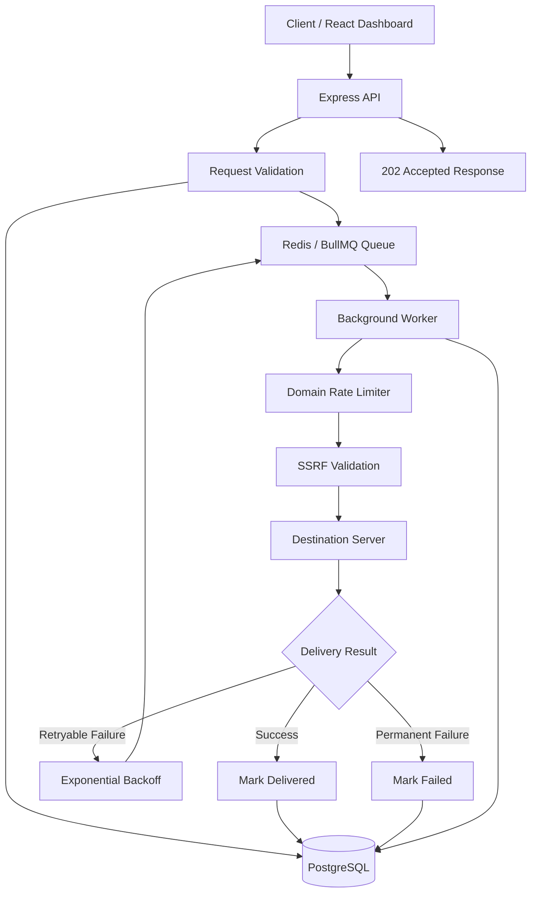

# Distributed Webhook Dispatcher

**An asynchronous, reliable, and scalable webhook delivery system built with Node.js, TypeScript, BullMQ, Redis, PostgreSQL, and React.**

[](https://nodejs.org/)
[](https://www.typescriptlang.org/)
[](https://redis.io/)
[](https://www.postgresql.org/)
[](https://www.docker.com/)

---

## Overview

Distributed Webhook Dispatcher is a backend system designed to deliver webhooks reliably without making the client wait for the destination server.

Instead of sending HTTP requests directly, the system places webhook events into a background queue. Dedicated workers process these events, handle failures, retry unsuccessful deliveries, and maintain delivery records.

The project also includes a React dashboard for monitoring webhook activity and delivery status.

## Problem It Solves

Traditional webhook implementations can face several problems:

- Slow destination servers can delay API responses.
- Temporary failures can result in lost webhook events.
- Repeated requests can overwhelm destination servers.
- Tracking delivery attempts and failures can be difficult.

**Solution:** An asynchronous queue-based architecture with background processing, automatic retries, rate limiting, persistent storage, and delivery monitoring.

## Key Features

- **Asynchronous Processing:** Immediately acknowledges incoming webhook requests with `202 Accepted`.
- **Background Workers:** Processes webhook deliveries independently using BullMQ.
- **Automatic Retries:** Retries failed requests using exponential backoff (2s, 4s, and 8s).
- **Delivery Tracking:** Stores webhook events and delivery attempts in PostgreSQL.
- **Rate Limiting:** Controls request frequency per destination domain using Redis.
- **Idempotency:** Prevents duplicate event processing using unique event IDs.
- **SSRF Protection:** Validates destination URLs and protects against private IP and DNS rebinding attacks.
- **Failure Handling:** Handles HTTP errors, network failures, and request timeouts.
- **Developer Dashboard:** Provides an interface to submit and monitor webhook events.
- **Docker Support:** Runs the application and its infrastructure using Docker Compose.

## Architecture



## How It Works

1. A client sends a webhook request to the API.
2. The API validates the request and checks event uniqueness.
3. The event is stored in PostgreSQL.
4. A background job is added to the BullMQ queue.
5. The API immediately returns `202 Accepted` with a job ID.
6. A worker picks up the queued job.
7. Redis rate limiting and destination security checks are performed.
8. The worker sends the HTTP POST request to the destination.
9. Delivery attempts and response details are stored in PostgreSQL.
10. Failed requests are retried according to the retry policy.

## Technology Stack

| Category | Technologies |
|---|---|
| Backend | Node.js, Express.js, TypeScript |
| Frontend | React, Vite, Tailwind CSS |
| Database | PostgreSQL, Prisma ORM |
| Queue | BullMQ, Redis |
| HTTP Client | Axios |
| Validation | Zod |
| API Documentation | Swagger / OpenAPI |
| Testing | Jest, Supertest |
| Infrastructure | Docker, Docker Compose |

## Project Structure

```text
distributed-webhook-dispatcher/
│
├── frontend/             # React dashboard
├── prisma/               # Database schema and migrations
├── docs/                 # Architecture documentation
├── scripts/              # Verification scripts
├── src/
│   ├── config/            # Application configuration
│   ├── modules/
│   │   ├── webhooks/      # Webhook API and business logic
│   │   └── mock/          # Mock destination endpoints
│   ├── queue/             # BullMQ queue configuration
│   ├── services/          # Delivery and retry services
│   ├── utils/             # Utility and security functions
│   ├── workers/           # Background workers
│   ├── app.ts
│   └── server.ts
│
├── tests/                 # Unit and integration tests
├── Dockerfile
├── docker-compose.yml
├── postman_collection.json
├── package.json
└── README.md
```

## Getting Started

### Prerequisites

Make sure you have installed:

- Node.js
- npm
- Docker Desktop
- Git

### 1. Clone the Repository

```bash
git clone https://github.com/Krishn-01/distributed-webhook-dispatcher.git

cd distributed-webhook-dispatcher
```

### 2. Install Dependencies

```bash
npm install
```

### 3. Configure Environment Variables

Create your local environment file:

**Windows PowerShell:**

```powershell
Copy-Item .env.example .env
```

Update the database and Redis configuration if required.

### 4. Start the Application

Start PostgreSQL, Redis, API, and the background worker:

```bash
docker compose up --build -d
```

Check the running containers:

```bash
docker compose ps
```

### 5. Access the Application

| Service | URL |
|---|---|
| Dashboard | http://localhost:3000 |
| API | http://localhost:3000 |
| Swagger Documentation | http://localhost:3000/docs |
| Health Check | http://localhost:3000/health |

## API Endpoints

| Method | Endpoint | Description |
|---|---|---|
| POST | `/api/webhooks/dispatch` | Submit a webhook |
| GET | `/api/webhooks` | List webhook events |
| GET | `/api/webhooks/:jobId` | Get webhook status |
| GET | `/api/webhooks/:jobId/attempts` | Get delivery attempts |
| GET | `/health` | Check application health |
| GET | `/docs` | API documentation |

### Submit a Webhook

**Request:**

```http
POST /api/webhooks/dispatch
Content-Type: application/json
```

```json
{
  "destinationUrl": "https://httpbin.org/post",
  "eventId": "evt_123456",
  "payload": {
    "event": "user.signup",
    "userId": "usr_999"
  }
}
```

**Successful Response:**

```json
{
  "status": "queued",
  "jobId": "generated-job-id",
  "eventId": "evt_123456"
}
```

The API returns `202 Accepted` without waiting for the destination server to complete delivery.

## Retry Mechanism

The worker automatically retries temporary delivery failures.

| Attempt | Delay |
|---|---|
| Initial Request | Immediate |
| Retry 1 | 2 seconds |
| Retry 2 | 4 seconds |
| Retry 3 | 8 seconds |

Maximum delivery attempts: **4 (1 initial + 3 retries).**

Retryable failures include HTTP 5xx responses, HTTP 429 responses, timeouts, and network errors.

Permanent client errors such as HTTP 400 and 404 are not retried.

## Testing

The project includes unit and integration tests.

Run all tests:

```bash
npm test
```

Run unit tests:

```bash
npm run test:unit
```

Run integration tests:

```bash
npm run test:integration
```

Build the project:

```bash
npm run build
```

**Verified test results:**
- Unit tests: 45 passed.
- Integration tests: 26 passed.
- Total: 71 tests passed across 9 test suites.

## Docker Commands

View application logs:

```bash
docker compose logs -f
```

Check container status:

```bash
docker compose ps
```

Stop the containers:

```bash
docker compose down
```

## Security

Security is an important part of the dispatcher.

- Validates destination URLs before making outbound requests.
- Blocks private, loopback, and reserved IP addresses in protected mode.
- Protects against cloud metadata access.
- Uses DNS IP pinning to reduce DNS rebinding risks.
- Disables automatic HTTP redirects to prevent redirect-based SSRF bypasses.

## Future Improvements

- Webhook authentication and signing.
- Dead-letter queue support.
- Advanced delivery analytics.
- Horizontal worker scaling.
- More comprehensive monitoring and observability.

## Author

**Krishna Kumar Pandey**

B.Tech – Information Technology

GitHub: [Krishn-01](https://github.com/Krishn-01)

Project Repository: [Distributed Webhook Dispatcher](https://github.com/Krishn-01/distributed-webhook-dispatcher)

---

*Built to explore reliable asynchronous processing, distributed queues, backend architecture, and webhook delivery systems.*